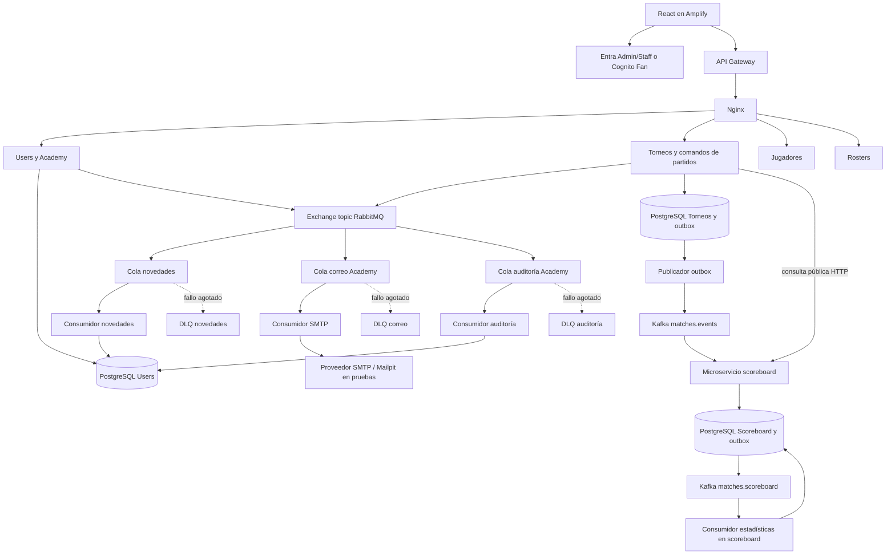

# Blackout Esports — entrega final

## Qué contiene esta versión

La rama feature-entrega-final reúne Academy (RabbitMQ) y Partidos en vivo (Kafka). No equivale a un despliegue ya realizado: la web anterior permanece en la rama de entrega 2 hasta publicar y verificar la nueva. El usuario pidió trabajar con AWS apagado y no autorizó aumentar la instancia.

Repositorios y referencias:

| Repositorio | Referencia para esta entrega |
|---|---|
| matias-fer/BlackoutEsports-FrontAdmin | feature-entrega-final |
| joaquinnn6/BlackoutEsports-Tournaments-Backend | feature-entrega-final; incluye módulos blackout-tournaments, scoreboard y kafka-admin |
| joaquinnn6/BlackoutEsports-Users-Backend | feature-entrega-final; incluye Academy, correo y auditoría |
| joaquinnn6/BlackoutEsports-RabbitAdmin-Backend | feature-entrega-final |
| matias-fer/BlackoutEsports-Backend | feature-entrega-2-rabbitmq, commit db1e5ee |
| joaquinnn6/BlackoutEsports-Roster-Backend | feature-entrega-2-rabbitmq, commit 4d2302d |

Los nuevos servicios tienen pom.xml, Dockerfile y src/main y src/test. scoreboard y kafka-admin comparten repositorio con Torneos, pero se compilan y ejecutan por separado. scoreboard tiene PostgreSQL propio. No hace falta crear repositorios vacíos para llamarlos microservicios.

## Arquitectura

El navegador consulta el marcador cada dos segundos. Kafka comunica procesos del backend; el navegador no se conecta directamente a un broker. Es una actualización cuasi en tiempo real mediante polling. Nginx enruta peticiones; no agrega por sí mismo lógica de negocio de un BFF.

## Flujo Academy

1. El fan inicia sesión con Cognito y completa la postulación. Users confirma el correo con Cognito UserInfo; no acepta que el formulario elija un destinatario distinto.
2. Admin/Staff revisa. Una aceptación exige fecha futura y lugar/enlace; un rechazo no. La decisión es definitiva para esta convocatoria.
3. La transacción guarda la decisión y la publicación pendiente. El publicador espera confirmación del broker antes de quitar la marca.
4. El exchange topic entrega copias a correo y auditoría mediante bindings diferentes. Un fallo de SMTP no bloquea el registro de la decisión.
5. El correo se confirma al aceptar SMTP; puede caer en spam o no llegar después. Los fallos agotados quedan en DLQ y logs. La auditoría queda visible para el staff.

## Flujo de partidos

1. Admin/Staff crea el partido de un torneo, lo inicia y registra ganadores A/B.
2. Cada comando lleva expectedVersion. El servidor rechaza una versión vieja (409), evitando que dos clics o administradores sobrescriban el estado.
3. Torneos guarda el estado y la outbox en la misma transacción. Publica una instantánea con matchId como clave.
4. scoreboard consume, ignora versiones repetidas/antiguas y persiste el marcador con su propia outbox.
5. Publica al segundo tópico; otro grupo consume resultados para las estadísticas.
6. Anular solo pide confirmación y quita la última ronda válida; no solicita nombre. Finalizar exige un ganador.

acks=all y min.insync.replicas=2 exigen confirmaciones de las réplicas sincronizadas con al menos dos disponibles. Las versiones hacen idempotente la proyección, pero no afirmamos entrega exactly-once entre Kafka y PostgreSQL. Los topics tienen tres particiones, tres réplicas y retención de siete días. Ambos tienen DLT. La outbox publicada conserva historial y necesita una política futura de archivado.

## Qué prueban los workflows

- Torneos: comandos y permisos; marcador independiente; Kafka real con tres ZooKeeper y tres brokers; flujo con un broker detenido y recuperación; DLT; administración de un tópico temporal.
- Users: login/roles y CRUD; decisión única; auditoría idempotente; dos nodos RabbitMQ; aceptación y rechazo SMTP capturados por Mailpit; tres intentos de correo y tres DLQ.
- RabbitAdmin: operaciones del administrador y formación real del clúster.
- Frontend: flujos Academy/marcador, confirmación de anulación y compilación; pruebas del plan de autorización del Gateway.

El resultado válido es el último workflow del commit entregado. Un workflow verde no demuestra que ese commit esté desplegado en AWS. Las pruebas de tokens locales usan llaves exclusivas de src/test, nunca credenciales de producción.

## Pendientes que requieren el entorno real

1. Capacidad: la t3.small dejó 221 MB disponibles y usaba swap. No levantar todo allí sin resolver recursos. No se autorizó ampliarla.
2. Configurar un remitente/proveedor SMTP y verificar recepción externa. Mailpit prueba el protocolo y contenido, no entrega a Gmail/Outlook.
3. Preparar migración del RabbitMQ antiguo al clúster nuevo conservando mensajes y volumen anterior. No usar down -v con datos reales.
4. Desplegar Users, Torneos, scoreboard, administradores, clusters y nueva rama Amplify. Registrar su URL SPA en Entra y callbacks/logout en Cognito; actualizar CORS.
5. Revisar y aplicar el plan deploy/gateway_jwt.py al HTTP API existente; probar JWT reales, rutas públicas, fans y staff. La autorización de roles sigue en los backends.
6. Hacer la prueba completa con dos navegadores y guardar evidencias del entorno final.

Dos nodos quorum RabbitMQ no toleran perder uno: falta mayoría. Tres brokers Kafka en una sola EC2 tampoco toleran perder esa EC2. Se distingue tolerancia a proceso/broker de tolerancia al host.

## Guion de demostración (5–10 minutos)

1. Mostrar arquitectura, sesiones Cognito/Entra y una escritura rechazada sin permiso.
2. Postular como fan, aceptar/rechazar con staff y mostrar correo más registro de decisión.
3. Mostrar las tres colas, DLQ, exchanges direct/topic y explicar bindings, ACK/NACK y tres intentos.
4. Abrir dos navegadores; sumar rondas A/B, anular con confirmación y finalizar.
5. Mostrar dos tópicos, particiones, réplicas, grupos, offsets y lag en Kafka UI. Explicar las claves y las instantáneas.
6. Demostrar administración con nombres de prueba y un fallo controlado en el entorno de ensayo. No borrar colas o tópicos de negocio.

La pauta EFT pide URLs de GitHub en AVA y copia al docente; el envío lo realiza el estudiante. También menciona defensa en video individual; confirmar con el profesor su relación con la presentación del 2 de diciembre. No se envió ningún mensaje ni entrega al docente desde esta sesión.
